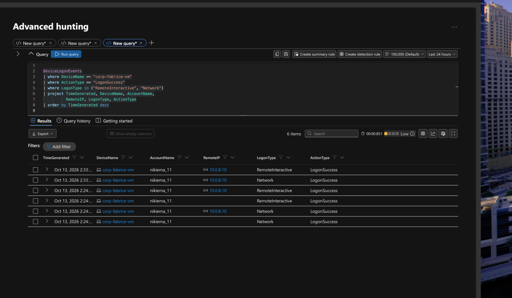
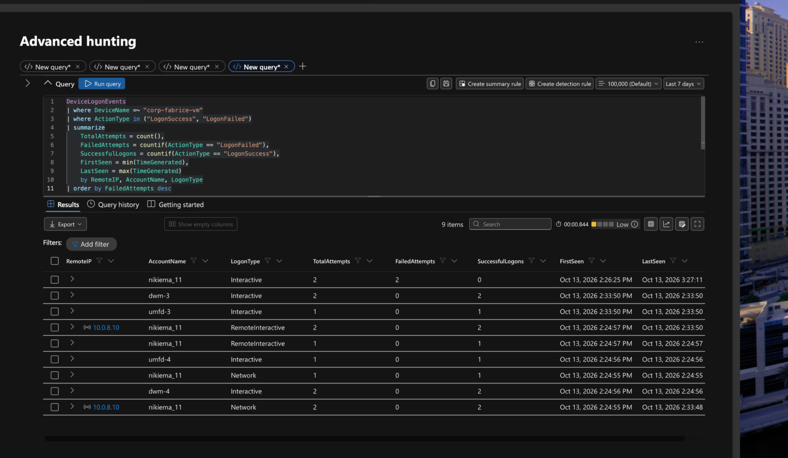
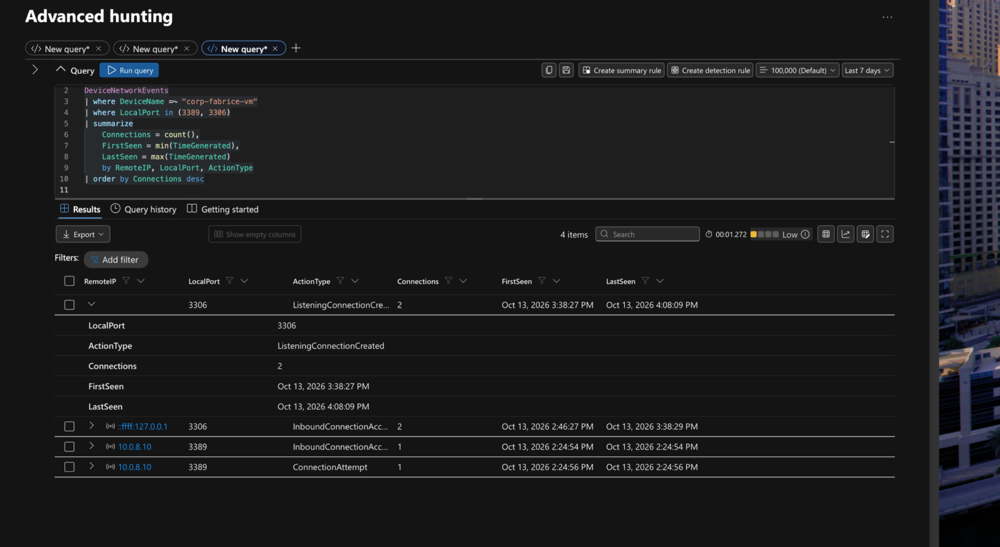
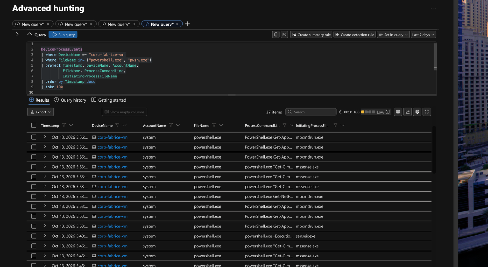
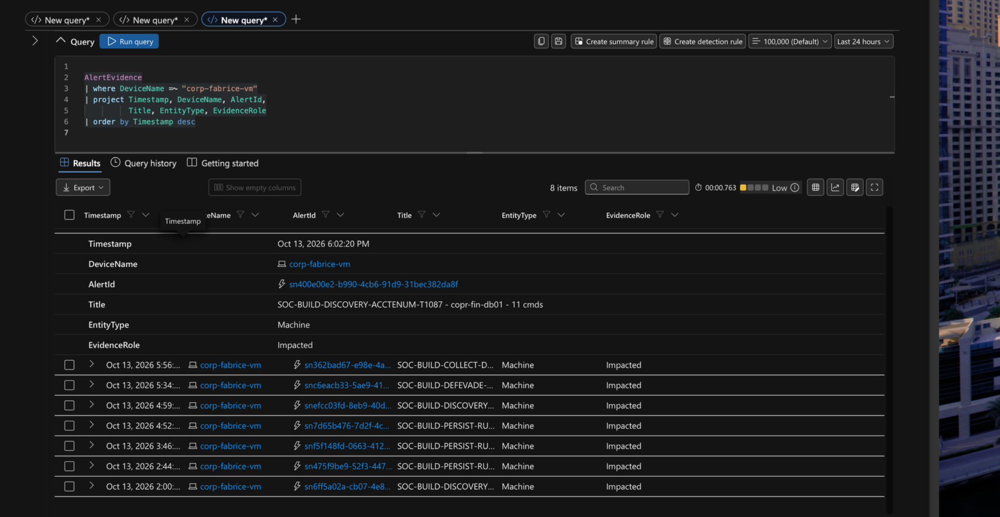
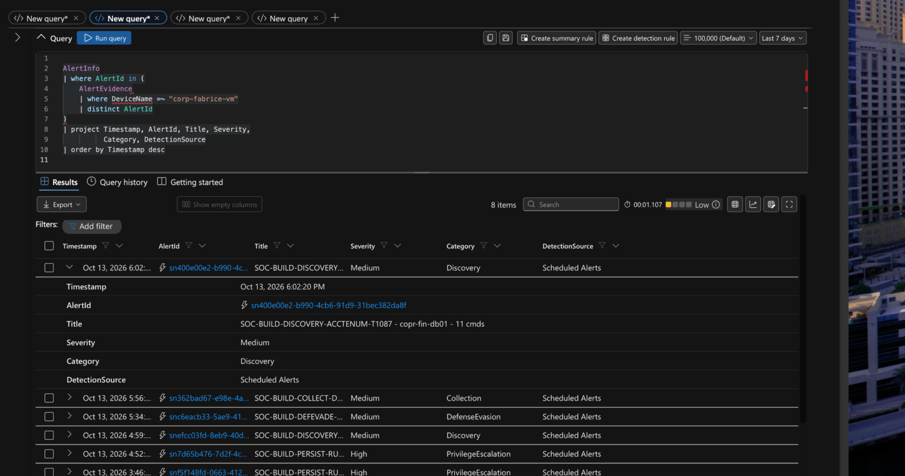
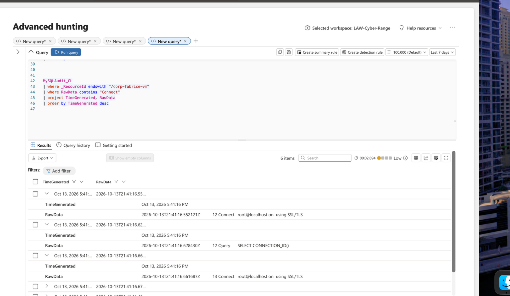
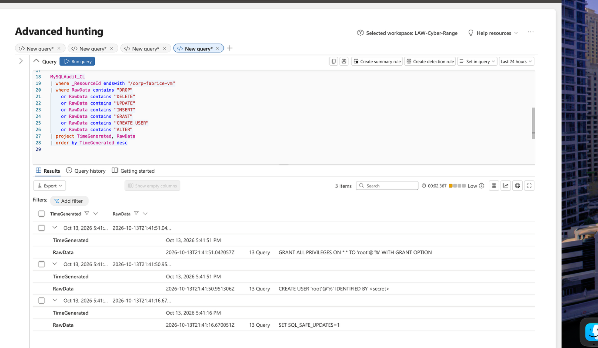

# Azure Honeypot Full Incident Investigation Report

**Analyst:** Fabrice Nikiema  
**Target:** `corp-fabrice-vm`  
**Case ID:** `IR-2026-1013-CFV`  
**Report date:** October 13, 2026  
**Platforms:** Azure, Microsoft Defender for Endpoint, Microsoft Sentinel / Log Analytics, MySQL  
**Status:** Evidence-based investigation; exposure start approximate, isolation time unverified.

This README presents the complete report content and its eight evidence screenshots. The PDF is not required to view the investigation. Original CSV exports are referenced as evidence sources but are not included in this package.

**Scope note:** This report uses the supplied eight CSV exports and the analyst-provided exposure estimate. It follows the section structure of the supplied sample report, but none of the sample host's indicators, dates, ransom narrative, or forensic package results have been transferred to findings for this VM.

## Contents

- [Executive Summary](#1-executive-summary)
- [Incident Details](#2-incident-details)
- [Evidence Inventory and Window Assessment](#3-evidence-inventory-and-window-assessment)
- [Impact Assessment](#4-impact-assessment)
- [Notable Findings and Indicators](#5-notable-findings-and-indicators)
- [Chronological Timeline](#6-chronological-timeline)
- [Root Cause and Attack Vector Assessment](#7-root-cause-and-attack-vector-assessment)
- [Response Actions](#8-response-actions)
- [Lessons Learned and Prioritized Recommendations](#9-lessons-learned-and-prioritized-recommendations)
- [Limitations and Evidence Integrity](#10-limitations-and-evidence-integrity)
- [Appendix A Reproducible KQL](#appendix-a-reproducible-kql)
- [Appendix B Resume Project Description](#appendix-b-resume-project-description)
- [Evidence Addendum and Screenshots](#evidence-addendum-and-screenshots)
- [MITRE ATTACK Mapping and Evidence Status](#mitre-attack-mapping-and-evidence-status)
- [Root Cause and Attack Vector Evidence Review](#root-cause-and-attack-vector-evidence-review)
- [Response Actions From Containment to Recovery](#response-actions-from-containment-to-recovery)
- [DFIR Comparison Scope and Limitations](#dfir-comparison-scope-and-limitations)

## 1 Executive Summary

On October 13, 2026, the analyst operated the Azure-hosted Windows honeypot corp-fabrice-vm, reportedly exposing it at approximately 4:00 PM Eastern Daylight Time (20:00 UTC) and subsequently isolating it. Eight exported telemetry datasets were reviewed for host, network, authentication, and MySQL activity. The supplied data shows host activity after the estimated exposure time and a privileged MySQL account configuration sequence at 5:41 PM EDT. However, it does not establish a successful external compromise, ransomware deployment, data theft, or database destruction. The supplied Windows logon export contains no records at or after the estimated exposure start. The large network-flow export covers October 12, not the reported October 13 exposure. These are material visibility gaps, not proof that no attack occurred.

## 2 Incident Details

| Field | Case-specific observation |
|---|---|
| Host | `corp-fabrice-vm` |
| Environment | Azure Windows VM; Microsoft Defender / Log Analytics; MySQL |
| Reported exposure | October 13, 2026, approximately 4:00 PM EDT (20:00 UTC) |
| Reported isolation | Occurred later; exact timestamp and control-plane evidence not supplied |
| Classification | Exposed honeypot / security telemetry investigation; compromise not confirmed |
| Severity | Undetermined from available evidence |
| Evidence scope | Eight CSV exports; original source filenames preserved |
| Analyst | Fabrice Nikiema |

## 3 Evidence Inventory and Window Assessment

| Source export | Data source | All rows | At or after 4 PM EDT |
|---|---|---:|---:|
| New query-6.csv | DeviceLogonEvents | 20 | 0 |
| New query-7.csv | DeviceProcessEvents | 1,280 | 779 |
| New query-8.csv | DeviceRegistryEvents | 1,027 | 673 |
| New query-9.csv | MySQL authentication subset | 6 | 6 |
| New query-10.csv | NTANetAnalytics / flow logs | 65,671 | 0 |
| New query-11.csv | MySQL query subset | 37 | 37 |
| New query-12.csv | DeviceNetworkEvents | 1,857 | 887 |
| New query-13.csv | DeviceFileEvents | 5,866 | 2,770 |

The post-4 PM counts are candidate records only: without the precise isolation timestamp, they have not been restricted to a verified exposure-to-isolation interval. The displayed TimeGenerated values in the October 13 MySQL logs align with EDT; embedded RawData timestamps are UTC (e.g., 5:41 PM EDT = 21:41 UTC). Verify the portal timezone for all other exports before forensic correlation.

## 4 Impact Assessment

Confidentiality: No confirmed data exfiltration is established by the supplied exports. Integrity: MySQL query telemetry includes creation of a wildcard-host root account and broad privileges; these changes are security-relevant, but the supplied evidence does not identify who initiated them or whether they were part of authorized lab setup. Availability: No verified destructive SQL, ransomware activity, or outage is established. Scope: One target VM is in scope; the October 12 flow dataset must not be attributed to the October 13 exposure without independent correlation.

## 5 Notable Findings and Indicators

| Finding | Observed evidence and interpretation |
|---|---|
| Privileged MySQL user | October 13, 5:41:50 PM EDT: `CREATE USER 'root'@'%' IDENTIFIED BY <secret>`; secret redacted in export |
| Privilege grant | October 13, 5:41:51 PM EDT: `GRANT ALL PRIVILEGES ON *.* TO 'root'@'%' WITH GRANT OPTION` |
| Local MySQL authentication | 5:41:11 PM EDT: `root@localhost` access denied without a password; subsequent local SSL/TLS connection entries |
| Windows logon coverage | 20 exported logon events, all between 2:24:55 PM and 3:27:11 PM EDT, before reported exposure |
| Host network telemetry | 887 of 1,857 exported device network events occur at or after 4 PM EDT; source, destination and process context require validation |
| Flow log timing | 65,671 flow records have TimeGenerated on October 12; zero fall on or after October 13 at 4 PM |

Do not treat Microsoft/Azure service endpoints, private addresses, loopback connections, or a MySQL configuration command as attacker IOCs without independent corroboration. The report does not list the sample report's unrelated malicious IP addresses or ransom markers.

## 6 Chronological Timeline

All times below are EDT on October 13, 2026.

| Time | Event | Source |
|---|---|---|
| Approximately 4:00 PM | Analyst-reported VM exposure | Analyst statement |
| 4:08:09 PM | MySQL listening connection created on TCP/3306 | DeviceNetworkEvents |
| 5:41:11 PM | Local MySQL root connection and passwordless authentication denial | MySQL authentication export |
| 5:41:16 PM | MySQL local connection/session setup and query activity | MySQL authentication and query exports |
| 5:41:50 PM | Wildcard-host MySQL root account creation | MySQL query export |
| 5:41:51 PM | ALL PRIVILEGES grant to `root@%` | MySQL query export |
| Later, unverified | Analyst reports VM isolation; precise time and method pending | Analyst statement |

## 7 Root Cause and Attack Vector Assessment

An initial-access mechanism cannot be established from these exports. Although the lab was intentionally exposed, the submitted DeviceLogonEvents records end before the stated exposure time, and the supplied flow analytics dataset predates exposure by approximately one day. The MySQL account-creation and GRANT commands are high-risk configuration events; they are not, on their own, proof of an adversary. Correlate Azure NSG and VM Activity Logs, public-IP assignment history, MySQL audit identity/session context, and complete Defender logon records before drawing an attack-vector conclusion.

## 8 Response Actions

Reported: The analyst states the VM was isolated after exposure. The exact timestamp, method (NSG deny rule, public-IP removal, VM shutdown, or other action), and Azure Activity Log evidence were not provided. Recommended: Preserve original exports and record hashes; retrieve NSG rule-change and VM activity timestamps; restrict inbound RDP/MySQL access; validate the intent and current privileges of root@%; rotate credentials if unauthorized exposure is confirmed; and retain the honeypot evidence in a read-only location.

## 9 Lessons Learned and Prioritized Recommendations

- Verify the exposure and isolation window from Azure Activity Log/NSG configuration history before finalizing an incident timeline.

- Collect continuous authentication and network-flow telemetry covering the actual exposure window; current exports leave gaps.

- Alert on MySQL CREATE USER, GRANT ALL, wildcard-host administrative accounts, and anomalous remote authentication.

- Correlate network connections with process ancestry, user context, destination reputation, and cloud service baselines before labeling them malicious.

- Keep UTC-normalized timestamps, original CSVs, query text, screenshots, and SHA-256 hashes for reproducible analysis.

## 10 Limitations and Evidence Integrity

This assessment is constrained by the analyst-estimated start time, the unverified isolation endpoint, no post-exposure Windows logon events in the provided export, and network analytics data from the previous day. Some source files are filtered subsets rather than complete raw tables. A negative search result or absence of events in a partial export does not prove absence of malicious activity. The sample PDF’s confirmed ransomware case and separate pre/post DFIR package comparison are not evidence for this host. No comparable MDE live-response forensic packages were supplied for corp-fabrice-vm.

## Appendix A Reproducible KQL

### Defender host activity

```kql
DeviceNetworkEvents
| where DeviceName =~ "corp-fabrice-vm"
| where Timestamp >= datetime(2026-10-13T20:00:00Z)
| order by Timestamp asc
```

### Windows logons

```kql
DeviceLogonEvents
| where DeviceName =~ "corp-fabrice-vm"
| where Timestamp >= datetime(2026-10-13T20:00:00Z)
| summarize Failures=countif(ActionType == "LogonFailed"),
    Successes=countif(ActionType == "LogonSuccess")
    by RemoteIP, AccountName
```

### MySQL changes in Log Analytics

```kql
MySQLAudit_CL
| where TimeGenerated >= datetime(2026-10-13T20:00:00Z)
| where _ResourceId endswith "/corp-fabrice-vm"
| where RawData has_any ("CREATE USER", "GRANT", "DROP", "REVOKE")
| order by TimeGenerated asc
```

Set an upper bound after confirming the isolation timestamp. Defender Advanced Hunting and Log Analytics have different schemas and query interfaces. Queries above reproduce the source report's examples.

## Appendix B Resume Project Description

**Azure Honeypot Threat Investigation | Microsoft Defender, Sentinel, KQL, MySQL**

- Collected and analyzed eight Windows endpoint, MySQL audit, and network-flow CSV exports from an Azure honeypot to build an evidence-based incident timeline.
- Investigated privileged MySQL account creation and GRANT activity, correlated host/network telemetry, and identified exposure-window and logging coverage gaps.
- Documented findings, investigative limitations, and prioritized hardening recommendations in a structured incident response report.

## Evidence Addendum and Screenshots

**Host:** `corp-fabrice-vm`  
**Investigation date:** October 13, 2026  
**Time context:** EDT

These screenshots were captured during this investigation and supplement the eight original CSV exports. The sample report describes a separate host and is used as a methodological template, not as evidence that ransomware affected this VM.

Reported exposure was approximately 4:00 PM EDT (20:00 UTC). Isolation time remains unverified. Pre-exposure screenshots or events are contextual and should not be classified as post-exposure attacks.

### Evidence Figure 1

**Windows logon query results**  
Original screenshot: `Screenshot 2026-10-13 at 7.02.31 PM.png`



Defender Advanced Hunting: selected endpoint query results. Source: analyst-supplied screenshot. Refer to the matching CSV export for row-level verification.

### Evidence Figure 2

**Windows authentication activity summary**  
Original screenshot: `Screenshot 2026-10-13 at 7.04.13 PM.png`



Defender Advanced Hunting: selected endpoint query results. Source: analyst-supplied screenshot. Refer to the matching CSV export for row-level verification.

### Evidence Figure 3

**RDP network investigation**  
Original screenshot: `Screenshot 2026-10-13 at 7.07.56 PM.png`



Defender Advanced Hunting: selected endpoint query results. Source: analyst-supplied screenshot. Refer to the matching CSV export for row-level verification.

### Evidence Figure 4

**PowerShell process investigation**  
Original screenshot: `Screenshot 2026-10-13 at 7.11.02 PM.png`



Defender Advanced Hunting: selected endpoint query results. Source: analyst-supplied screenshot. Refer to the matching CSV export for row-level verification.

### Evidence Figure 5

**Defender alert evidence**  
Original screenshot: `Screenshot 2026-10-13 at 7.13.10 PM.png`



Defender Advanced Hunting: selected endpoint query results. Source: analyst-supplied screenshot. Refer to the matching CSV export for row-level verification.

### Evidence Figure 6

**Defender alert metadata**  
Original screenshot: `Screenshot 2026-10-13 at 7.16.57 PM.png`



Defender Advanced Hunting: selected endpoint query results. Source: analyst-supplied screenshot. Refer to the matching CSV export for row-level verification.

### Evidence Figure 7

**MySQL authentication audit**  
Original screenshot: `Screenshot 2026-10-13 at 6.10.14 PM.png`



Microsoft security hunting results and query output. Source: analyst-supplied screenshot. Refer to the matching CSV export for row-level verification.

### Evidence Figure 8

**MySQL account creation and privilege grants**  
Original screenshot: `Screenshot 2026-10-13 at 6.07.25 PM.png`



Microsoft security hunting results and query output. Source: analyst-supplied screenshot. Refer to the matching CSV export for row-level verification.

## MITRE ATTACK Mapping and Evidence Status

T1110 Brute Force: Failed logons were observed, but the exported logon records precede the reported 4:00 PM exposure. No post-exposure brute-force campaign is established from that export.

T1021.001 Remote Desktop Protocol: RDP-related connections were observed in prior screenshots. Verify timestamps and source attribution before classifying as adversary remote access.

T1059.001 PowerShell: PowerShell process events exist; the targeted suspicious-command search returned no matches. Execution alone is not malicious.

T1098 Account Manipulation: MySQL CREATE USER root@% and GRANT ALL PRIVILEGES were recorded at approximately 5:41 PM EDT. Verify whether these commands were performed during lab setup.

T1485 Data Destruction and T1486 Data Encrypted for Impact: These are techniques illustrated by the sample ransomware case, NOT confirmed for corp-fabrice-vm. Run the provided MySQL hunts and preserve any returned evidence.

Related scenario in the supplied sample: MySQL ransom-note creation, destructive DROP statements, and claimed data exfiltration on a DIFFERENT host in June 2026. This scenario can inform detection engineering, but its indicators must never be presented as October 13 findings for this VM.

Companion code: MITRE_ATTCK_Honeypot_Mapping.kql. Replace the placeholder end time with verified isolation time. Queries for Defender and Log Analytics run in their respective interfaces.

## Root Cause and Attack Vector Evidence Review

### Observed on corp-fabrice-vm

The supplied MySQL audit evidence includes CREATE USER root@% and GRANT ALL PRIVILEGES ON *.* TO root@% WITH GRANT OPTION. This is a high-risk database configuration because a wildcard-host superuser may enable remote administrative access when network controls permit it. Attribution is UNDETERMINED: confirm whether these statements were part of analyst lab setup.

### Authentication and external exposure

The 20 exported DeviceLogonEvents records are earlier than the reported October 13, 2026, approximately 4:00 PM EDT exposure. Earlier screenshots include unsuccessful logons and private-address RDP activity involving 10.0.8.10. They do not demonstrate post-exposure external brute force or a successful attacker login. Public-inbound hunting in the earlier screenshot returned zero results.

### Related sample - not this host

The provided sample describes a June 25-26 incident on corp-na01-fe123, including brute-force attempts, a remotely privileged MySQL user, ransom note, database drops and possible exfiltration. Those events, source IPs and affected business databases are NOT established for corp-fabrice-vm. The sample is useful for threat hypotheses and detection coverage, not as evidence of this host being compromised.

### Unresolved questions

Confirm the exact isolation time from Azure activity records, check whether root@% was created by the analyst, inspect SQL query exports for DROP DATABASE, RECOVER_YOUR_DATA and bulk reads, and reconcile alert names referring to corp-fin-db01 with device-linked AlertEvidence for corp-fabrice-vm.

## Response Actions From Containment to Recovery

### Reported action vs verified evidence

Analyst reports that corp-fabrice-vm was isolated approximately three hours before a prior chat message. Exact isolation time, mechanism and Azure control-plane audit artifact are not yet supplied. Treat isolation as analyst-reported, not independently verified.

### Containment priorities

Verify the network security group denies unwanted inbound access to RDP (TCP/3389) and MySQL (TCP/3306); avoid exposing these services publicly. Preserve original exported CSVs and record the final UTC investigation window. Review remote accounts and rotate any lab credentials exposed by the configuration.

### Eradication and hardening

Determine whether root@% is required. If not, remove wildcard-host superuser access after verifying legitimate dependencies. Restrict DB privileges, require strong authentication, enforce endpoint firewall policy and review persistence indicators in DeviceRegistryEvents, DeviceProcessEvents and DeviceFileEvents.

### Recovery and validation

Validate expected VM services and database contents after isolation. If any malicious DROP statements or ransom artifacts are later proven, recover from known-good backup and expand the scope of response. Do not assert a backup restoration or customer notification took place without supporting artifacts.

### Lessons learned

Prioritize exposure-window accuracy, alert-to-host correlation, least-privilege MySQL access, network segmentation, event-retention coverage, and alert rules for unexpected account creation, privilege grants, repeated failures, destructive SQL and ransomware-style file modifications.

## DFIR Comparison Scope and Limitations

### What the sample demonstrates

The reference PDF includes a separate pre/post MDE live-response package comparison: Windows Firewall changes, 32,621 failed logons, 32 account lockouts, RPC traffic, prefetch activity, autoruns and scheduled-task deltas. Its own verdict says the password spray was attempted, without confirmed successful attacker logon.

### What this investigation actually includes

For corp-fabrice-vm, eight CSV exports and Microsoft Defender/Sentinel screenshots were provided: DeviceLogonEvents (20), DeviceProcessEvents (1,280), DeviceRegistryEvents (1,027), DeviceNetworkEvents (1,857), DeviceFileEvents (5,866), MySQL authentication (6), MySQL query events (37) and network analytics (65,671). These are not equivalent to paired pre/post live-response investigation packages.

### Evidence limitations

No pre- and post-isolation MDE live-response packages, firewall baseline diff, 4625/4740 security.evtx comparison, administrator group snapshot, autoruns comparison or confirmed ransomware payload evidence were supplied for this host. Network analytics rows were exported from October 12 and require scoping before use in the October 13 exposure timeline.

### MITRE ATT&CK interpretation

T1098 Account Manipulation: candidate mapping for observed SQL account/grant changes, attribution pending. T1021.001 RDP and T1110 Brute Force: investigation hypotheses based on pre-exposure activity, not confirmed post-exposure attacker techniques. T1485 Data Destruction and T1486 Data Encrypted for Impact: related sample only, not observed on this VM.

### Resume-appropriate summary

Conducted an Azure honeypot investigation using Defender Advanced Hunting, Sentinel, KQL and MySQL audit telemetry; correlated endpoint/network/database evidence, evaluated ATT&CK hypotheses, and documented containment recommendations and visibility gaps.

## Companion Query File

The original report refers to `MITRE_ATTCK_Honeypot_Mapping.kql`. The companion query content supplied in the earlier GitHub package is included here as [`queries/MITRE_ATTCK_Hunting.kql`](queries/MITRE_ATTCK_Hunting.kql). Confirm the isolation time and review placeholders before executing it.
